# Tracera

Tracera is an evidence-backed engineering workspace that goes from a bug signal to a reviewed fix. Show it a bug report, a screenshot, a screen recording, or a meeting transcript and it indexes the repository into a versioned code graph, investigates the code with cited hypotheses, proposes a patch, reproduces the bug and verifies that exact patch in a Docker sandbox, and puts the diff and the evidence in front of a person to review.

Tracera is decision support, not an oracle. A generated explanation is not a confirmed root cause, and a generated patch is not a verified fix. Every record says whether it was observed, reported, or inferred, models only propose, and a result is called verified only when the stored sandbox run says so. Inference runs on Meta's Muse models: Muse Spark 1.3 for reasoning and vision, Muse Wonder for escalation, and SAM 3.1 for locating elements in screenshots.

## Live deployment

| | |
|---|---|
| Web app | https://tracera-gules.vercel.app |
| API | https://tracera-api.onrender.com ([`/healthz`](https://tracera-api.onrender.com/healthz), [`/readyz`](https://tracera-api.onrender.com/readyz)) |
| Judging account | Email `judge@tracera.example`, password `Tracera-Judge-4271` |

The judging account is a shared email-and-password account with the workspace **member** role, created for reviewers. It already has two registered, indexed repositories: `shop-ui` (Lumen Goods, a small shop whose cart page promises free shipping from $50 but charges $4.99 on an order of exactly $50.00) and `bench-shop`. **Continue with Google** is also on the sign-in page. The API and worker run in one container on Render's free plan in Singapore with a free Render Postgres, behind a Vercel static site that proxies `/api`. The free instance sleeps after 15 minutes without traffic and needs 40 to 50 seconds to wake; the web app wakes it from the browser and retries, and says so on screen. The container has no Docker, so the sandbox stages and applying a patch are **local-only**; the hosted deployment runs investigations as analysis and labels what it cannot do. Model calls draw on a shared daily budget.

## Walkthrough video

**The narrated walkthrough lives in `diagrams/walkthrough/` as `tracera-walkthrough.mp4`.** It shows both ways to run Tracera: the hosted website, and a local install on a laptop with its own database and Docker sandbox. On the laptop it follows a real Google Meet call from transcript import to a verified, applied patch, then analyses a screen recording and drives Tracera from a coding agent through MCP. The voiceover is synthetic and every scene has captions (`.srt` files sit next to the video). Long waits are sped up and labelled.

**Architecture and workflow diagrams:** all 25 are in [`diagrams/`](diagrams/), as editable draw.io sources (`diagrams/src/`) and PNG (`diagrams/png/`), indexed with titles and captions in [`diagrams/index.json`](diagrams/index.json). Each is embedded below in the section it explains.

## Contents

- [The problem](#the-problem)
- [How a bug flows](#how-a-bug-flows)
- [Reading the results: evidence and outcomes](#reading-the-results-evidence-and-outcomes)
- [Features](#features)
- [Architecture](#architecture)
- [Model gateway](#model-gateway)
- [Authentication](#authentication)
- [Data model](#data-model)
- [Security model](#security-model)
- [Hosted and local](#hosted-and-local)
- [Local setup](#local-setup)
- [Environment variables](#environment-variables)
- [Database migrations](#database-migrations)
- [Deployment](#deployment)
- [Tests](#tests)
- [Scope](#scope)
- [Repository layout](#repository-layout)
- [Acknowledgments](#acknowledgments)

## The problem

A bug report is a symptom: a sentence, a screenshot, a remark in a call. Turning it into a fix means finding the code, reproducing the failure, writing a change, and proving the change works. Teams do this by hand, and AI coding tools shortcut it with confident patches that nobody can tell from a guess: the output says "fixed" without showing what was observed.

Tracera makes each step explicit and inspectable:

- Which code the symptom points to, with citations into a versioned code graph and the git history.
- Which hypotheses were considered, ranked by the evidence behind them, and which one the checks supported.
- Whether the bug was reproduced in a sandbox, with run output and browser screenshots.
- Whether the proposed patch makes that reproduction pass, and what else it can reach.
- Who approved it and who authorized each step that touches a repository.

## How a bug flows

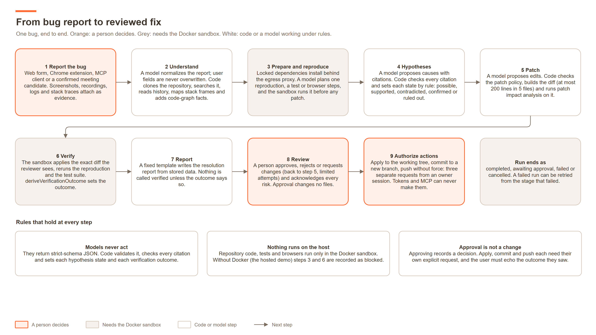

1. **Show the bug.** File a report with a description, steps, screenshots, a screen recording, logs, or stack traces, or import a meeting and confirm a candidate.
2. **Understand the evidence.** Tracera normalizes the report, parses traces and logs, reads screenshots and recording keyframes into labelled evidence, and collects bounded context from the repository and its git history.
3. **Investigate the code.** The code graph supports cited hypotheses about where the bug lives, ranked by evidence.
4. **Generate a fix.** A patch is proposed and checked against policy before anything runs.
5. **Run it in the sandbox.** Tests, or a browser reproduction for UI bugs, run in a locked-down Docker container: first to reproduce the bug, then against the patch.
6. **Verify.** The outcome is derived by rules from what the sandbox observed. A passing test suite alone never produces "verified".
7. **Review.** The diff, impact analysis, evidence and a resolution report are shown for a person to approve or reject. Approval records a decision and changes no files.
8. **Act, one authorization at a time.** Applying the patch to a working tree, committing it to a new branch, and pushing that branch are separate requests from a signed-in owner.

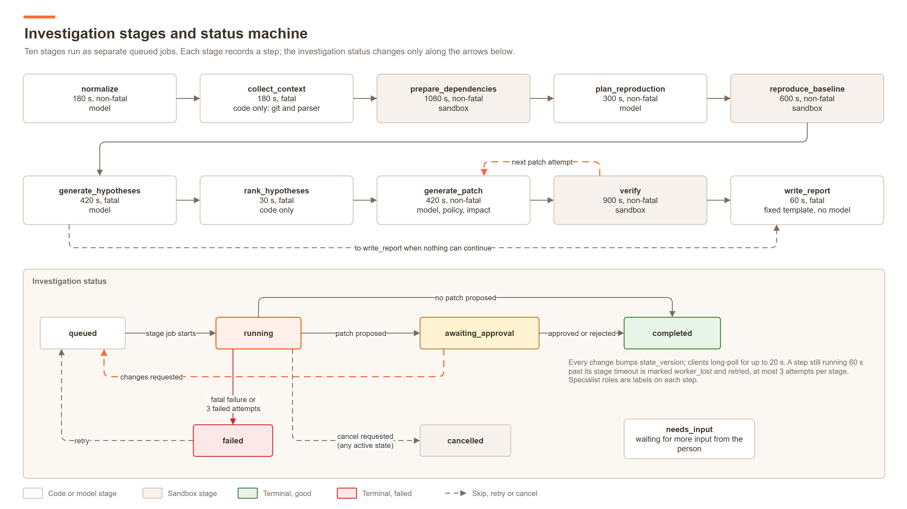

## Reading the results: evidence and outcomes

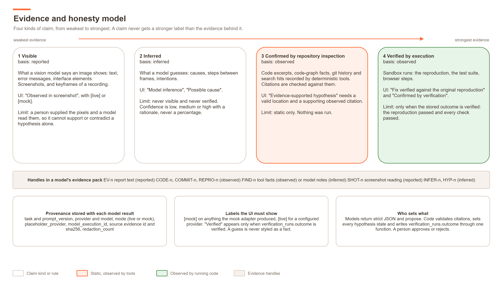

Everything a model sees or says carries a handle that states where it came from:

| Handle | Kind | Meaning |
|---|---|---|
| `EV-n`, `SHOT-n`, `REC-n` | reported | Text from the report, what a vision model read in a screenshot, what the keyframes of a recording show |
| `CODE-n`, `COMMIT-n`, `REPRO-n` | observed | A code excerpt, a commit, a sandbox reproduction run |
| `FIND-n` | observed or inferred | A tool fact (observed) or a model note (inferred) |
| `INFER-n`, `HYP-n`, `RECINFER-n` | inferred | A model's inference or hypothesis, never shown as fact |

Results are labelled `[live]` for a configured provider and `[mock]` for the deterministic mock adapter. Hypothesis states and verification outcomes are set only by code, and `verification_runs.outcome` is written by one function:

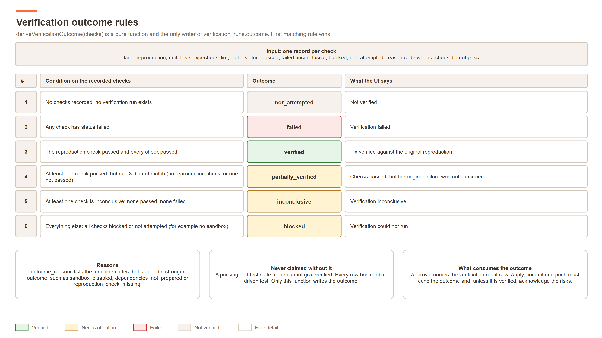

| Outcome | Rule | UI wording |
|---|---|---|
| `not_attempted` | No verification run exists | Not verified |
| `failed` | Any check failed | Verification failed |
| `verified` | The reproduction check passed and every check passed | Fix verified against the original reproduction |
| `partially_verified` | Something passed, but the reproduction did not | Checks passed, but the original failure was not confirmed |
| `inconclusive` | A check was inconclusive; none passed, none failed | Verification inconclusive |
| `blocked` | All checks blocked or not attempted, for example with no sandbox | Verification could not run |

## Features

Each feature below covers what it does and how it works.

- [Repositories and the code graph](#repositories-and-the-code-graph)
- [Questions, feasibility, and impact](#questions-feasibility-and-impact)
- [Screenshot understanding](#screenshot-understanding)
- [Screen recordings](#screen-recordings)
- [Reproduction in the sandbox](#reproduction-in-the-sandbox)
- [Review and authorized actions](#review-and-authorized-actions)
- [Meetings and Google Meet](#meetings-and-google-meet)
- [Chrome extension](#chrome-extension)
- [MCP server](#mcp-server)
- [Demo repositories](#demo-repositories)

### Repositories and the code graph

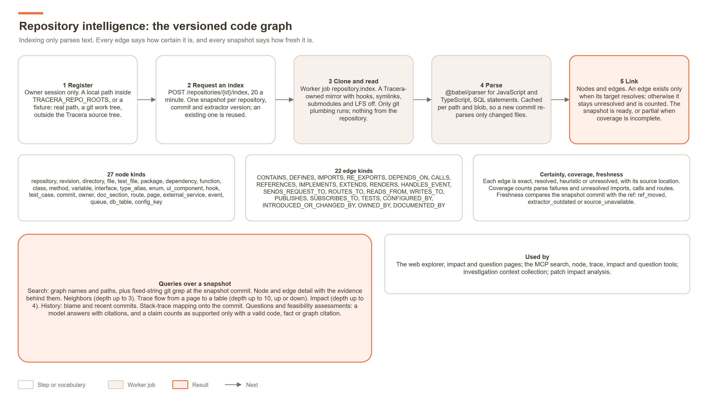

Register a local git repository inside `TRACERA_REPO_ROOTS` with its install, test, and optional start commands. Tracera indexes it into a versioned graph for JavaScript, TypeScript, and SQL: files, symbols, calls, routes, client requests, events, data access, and configuration reads. Indexing only parses text, never runs repository code, and is incremental per commit. Other languages are detected and counted.

### Questions, feasibility, and impact

Ask the codebase a question and get an answer whose claims cite graph nodes and code. Ask for a feasibility and change-size assessment. **Patch impact** takes two revisions or a diff and reports what changed, which tests cover it, and what it can reach.

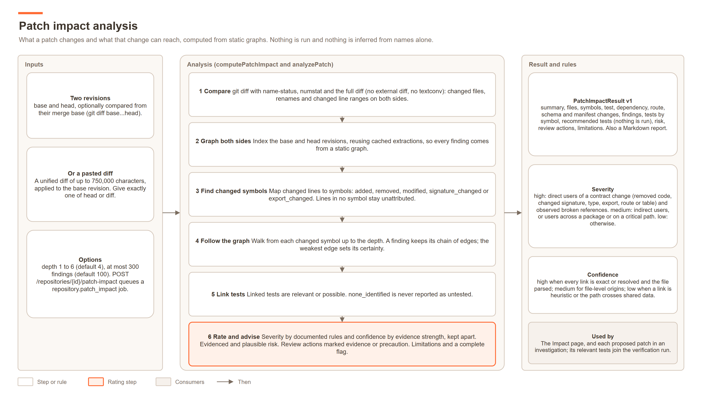

### Screenshot understanding

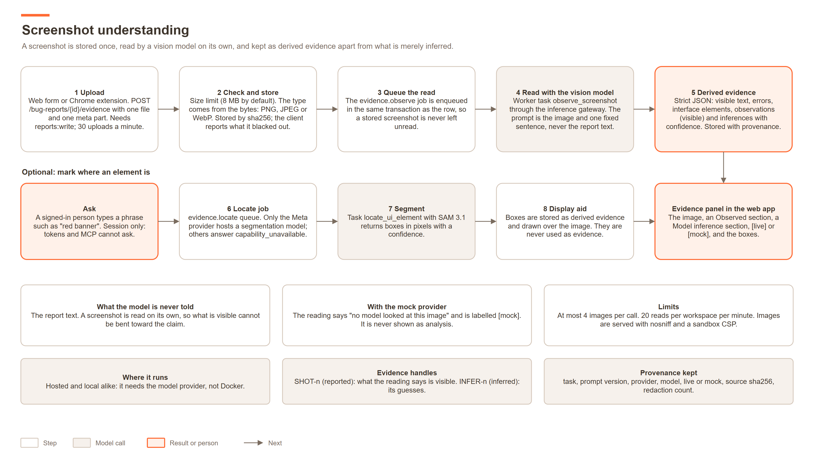

Attach a screenshot to a bug report (from the form or the extension). A vision model reads it into derived evidence: visible text, error messages, interface elements. That evidence is labelled `[mock]` or `[live]`, stored as `SHOT-n` (reported), and kept apart from what is inferred. On request SAM 3.1 marks where a named element sits in the screenshot, as a display aid and not as proof of a defect.

### Screen recordings

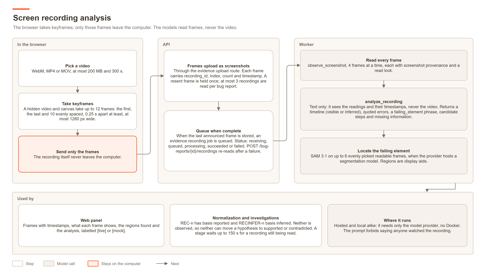

Attach a screen recording. The browser samples keyframes (the first, the last, and ten evenly spaced, at most 1280 px wide, with timestamps) and uploads only those frames through the screenshot evidence path; the recording itself never leaves the browser. Each frame is read like a screenshot, a text-only step builds a timeline (visible versus inferred), error messages, the failing element, and inferred repro steps, and SAM 3.1 runs on at most six frames. The analysis reaches the investigation as `REC-n` (reported) and `RECINFER-n` (inferred), neither of which can move a hypothesis on its own, and every label says it rests on N keyframes at stated timestamps.

### Reproduction in the sandbox

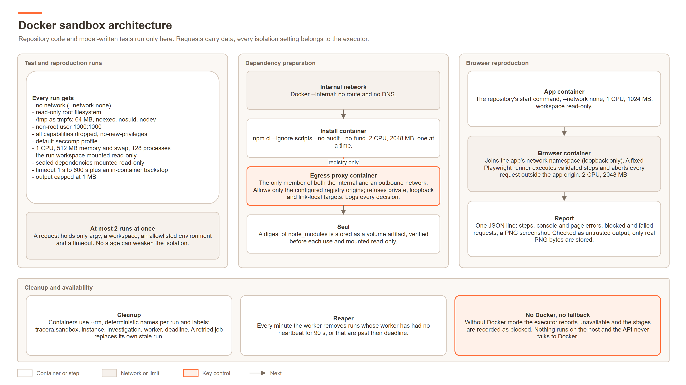

Dependencies are installed from lockfiles without lifecycle scripts, through a proxy that admits only the configured registry. Tests and checks run in a container with no network, a read-only root filesystem, a non-root user, dropped capabilities, and CPU, memory, process, and time limits. For UI bugs Tracera starts the registered app in the sandbox, reproduces the bug in a browser, and runs the same steps against the patched app; the review page shows the before and after screenshots with each step's result.

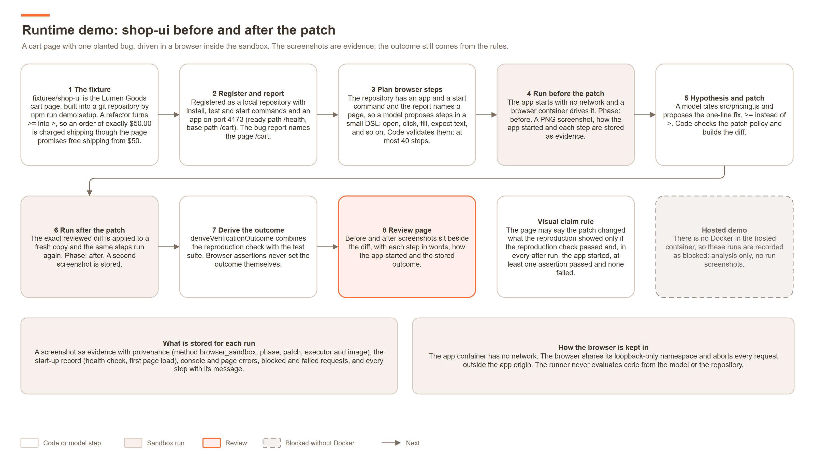

### Review and authorized actions

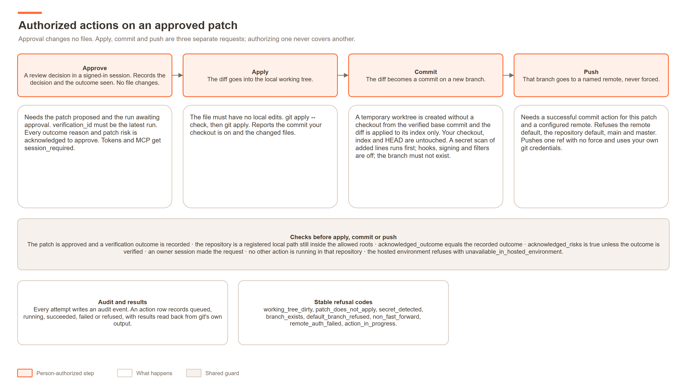

A person reviews the diff, impact, evidence, and risks, then approves or rejects. Approval is a session-only decision and changes no files. Applying the patch to the local working tree, committing it to a new branch (from a temporary worktree, with a secret scan of the added lines), and pushing that branch (never forced, never to the default branch) are three separate requests that only a signed-in owner session can make. Each must echo the verification outcome the person saw and acknowledge the risks unless the outcome is `verified`, runs git with hooks disabled, and writes an audit event. API tokens and MCP clients get `session_required`.

### Meetings and Google Meet

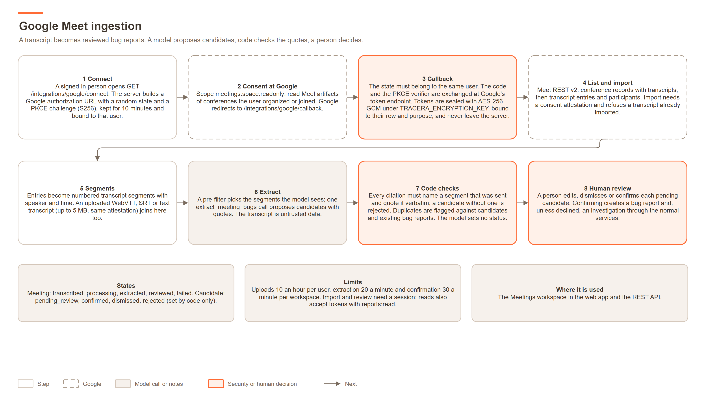

Meetings turn what people said in a call into reviewed bug reports. A model reads the transcript and proposes candidates; code rejects any candidate whose quotes do not occur verbatim in the segments it cites and flags likely duplicates, and the model sets no status. A person edits, dismisses, or confirms each remaining candidate, and confirming creates a bug report and, unless declined, an investigation.

- **Upload** a `.vtt`, `.srt`, or `.txt` transcript up to 5 MB, with an attestation that you may share it.
- **Import from Google Meet.** The Meetings page connects a Google account (OAuth with state and PKCE, the single read-only scope `meetings.space.readonly`), lists conferences that have transcripts, and imports one into the same pipeline. Tokens are encrypted at rest with `TRACERA_ENCRYPTION_KEY`, and re-importing the same transcript is idempotent.

To enable the import, create an OAuth client in the Google Cloud console, enable the **Google Meet REST API**, add the scope `https://www.googleapis.com/auth/meetings.space.readonly`, and register the redirect URI `<web origin>/api/v1/integrations/google/callback`. While the consent screen is in testing mode only listed test users can connect. Google creates transcripts only on Workspace editions that support them, only when transcription was started in the call, and only after the meeting has ended. Microsoft Teams is not implemented; export a Teams transcript as WebVTT and upload it.

### Chrome extension

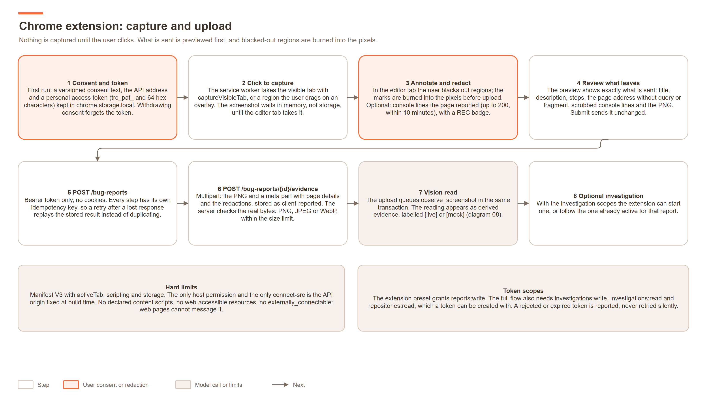

`apps/extension` is a Manifest V3 extension for reporting a bug from the page you are looking at. Click its icon, review what will be sent (title, description, steps, page address without query string or fragment, scrubbed console lines), black out regions of the screenshot (they are burned into the pixels before upload), and submit. It creates a bug report, uploads the screenshot as evidence, and can start an investigation. Nothing is captured until you click, and it needs a personal access token (client kind `extension`) that you paste once after accepting the consent text.

```sh
# the API and web origins are fixed at build time; the API origin becomes its only host permission
TRACERA_EXTENSION_DEFAULT_API_URL=<API origin> TRACERA_EXTENSION_DEFAULT_WEB_URL=<web origin> npm run build:extension
```

Open `chrome://extensions`, enable developer mode, and load `apps/extension/dist` unpacked. It works against a local or the hosted API.

### MCP server

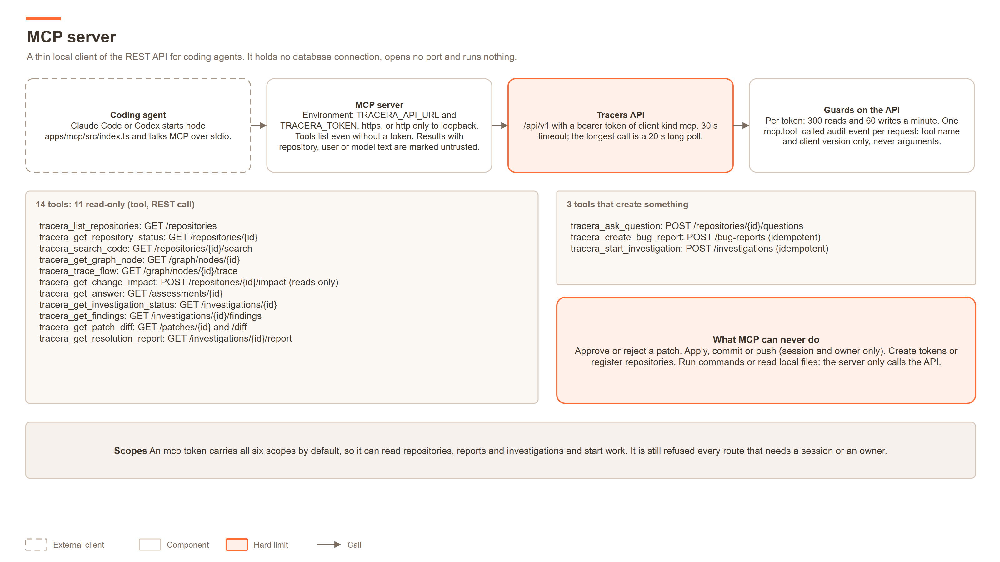

`apps/mcp` is a local stdio MCP server. Coding agents such as Claude Code and Codex use it to search a registered repository, ask evidence-backed questions, estimate change impact, report bugs, run investigations, and read findings, diffs, verification results, and reports. It is a thin client of the REST API: it holds no database connection, opens no ports, runs nothing on your machine, and cannot approve patches. Its 14 tools are `tracera_list_repositories`, `tracera_get_repository_status`, `tracera_search_code`, `tracera_get_graph_node`, `tracera_trace_flow`, `tracera_get_change_impact`, `tracera_ask_question`, `tracera_get_answer`, `tracera_create_bug_report`, `tracera_start_investigation`, `tracera_get_investigation_status`, `tracera_get_findings`, `tracera_get_patch_diff`, and `tracera_get_resolution_report`.

1. Create a personal access token with client kind `mcp`: sign in, then `POST /api/v1/tokens` with `{"name": "mcp", "client_kind": "mcp"}` (cookie-authenticated requests need the `X-Tracera-CSRF: 1` header and an `Origin` equal to `TRACERA_PUBLIC_URL`). The response contains the token secret once.
2. Register the server. Run it with `node` directly, not through `npm run`, because npm writes to stdout, which carries the protocol. `TRACERA_API_URL` defaults to `http://127.0.0.1:8787` (`https`, or plain `http` only to loopback); `TRACERA_TOKEN` is the token secret.

```sh
# Claude Code
claude mcp add tracera -s user \
  -e TRACERA_API_URL=http://127.0.0.1:8787 -e TRACERA_TOKEN=<token> \
  -- node /path/to/tracera/apps/mcp/src/index.ts
```

```toml
# Codex, ~/.codex/config.toml
[mcp_servers.tracera]
command = "node"
args = ["/path/to/tracera/apps/mcp/src/index.ts"]
env_vars = ["TRACERA_TOKEN"]

[mcp_servers.tracera.env]
TRACERA_API_URL = "http://127.0.0.1:8787"
```

### Demo repositories

`fixtures/shop-ui` (Lumen Goods) is a small cart page with one planted bug: an order of exactly $50.00 is charged shipping although the page promises free shipping from $50. A refactor commit turned `>=` into `>`. `npm run setup` creates it as a git repository named `shop-ui` and `npm run demo:setup` rebuilds it. Register it with the commands `npm ci --ignore-scripts`, `npm test`, and `npm run start` and the app `{ "port": 4173, "ready_path": "/health", "base_url_path": "/cart" }`, then report the bug with the page URL `http://localhost:4173/cart`. `eval/bench-shop` is the benchmark fixture (`npm run bench:setup`, `npm run bench:eval`).

## Architecture

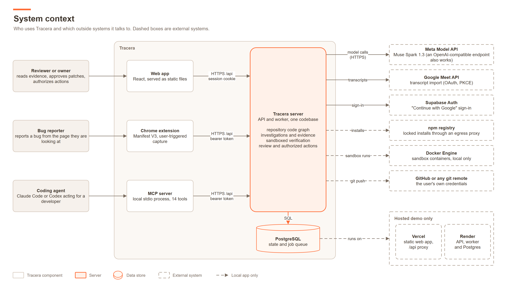

- `apps/server`: the REST API and the background worker (one codebase, two entrypoints), the inference gateway, and the Docker sandbox executor.
- `apps/web`: the React web workspace.
- `apps/mcp`: the MCP server.
- `apps/extension`: the Chrome extension.
- `packages/contracts`: every request, response, and model-output schema (Zod), imported by every client.
- PostgreSQL for state and the job queue; Docker for sandboxed execution.

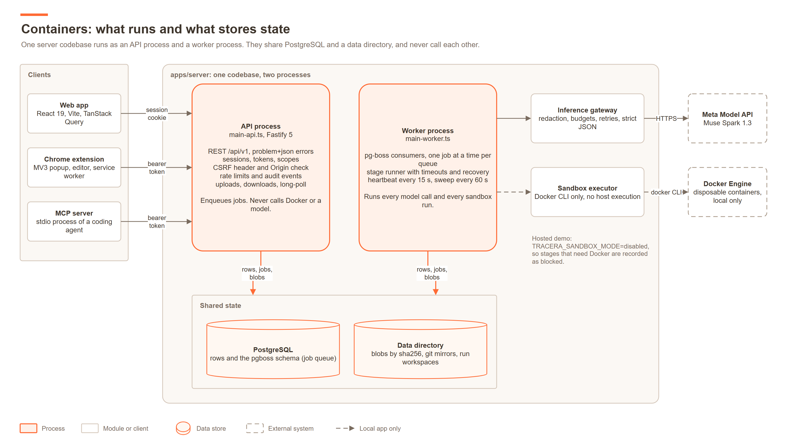

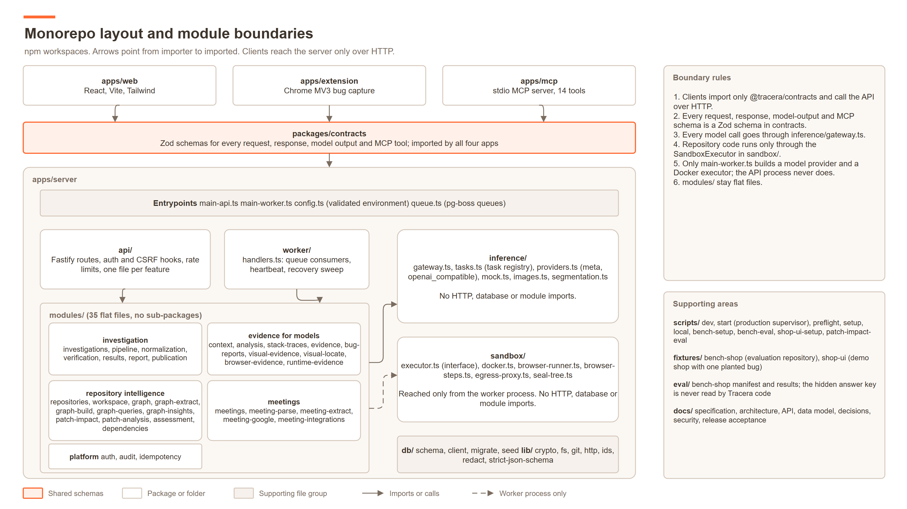

The API never calls Docker: long work (indexing, each investigation stage, evidence analysis, meeting extraction) runs as queued jobs on the worker, which owns the sandbox.

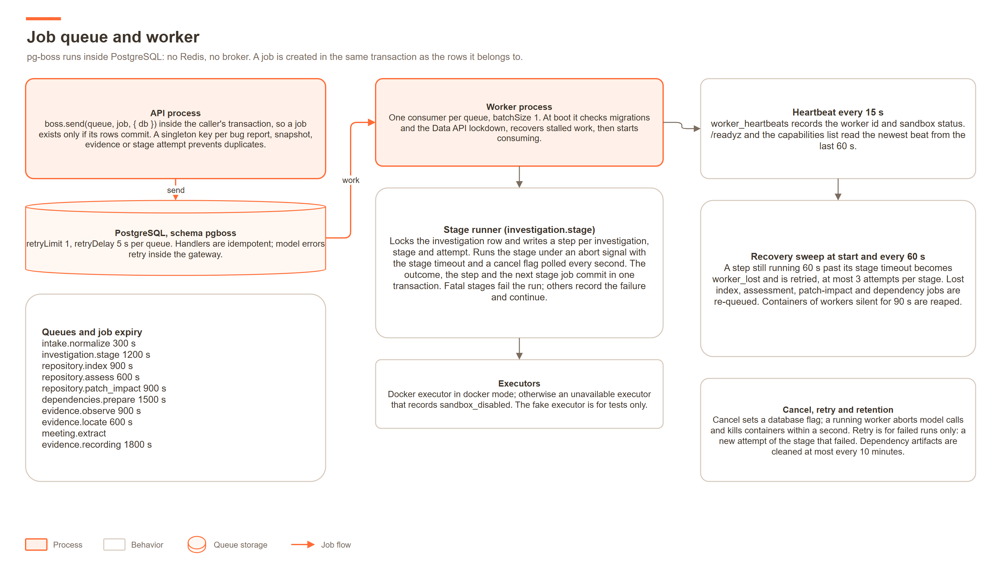

**Stack:** TypeScript on Node.js 24 (run directly, no build step), Fastify, PostgreSQL with Drizzle ORM, pg-boss for background jobs, Zod schemas shared through `packages/contracts`, React with Vite and Tailwind for the web app, Docker for the sandbox, Vitest and Playwright for tests.

## Model gateway

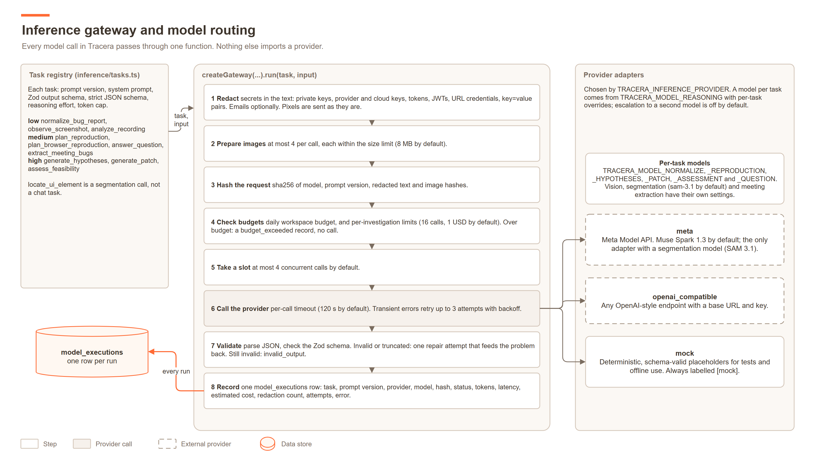

Every model call goes through one gateway with a task registry and three adapters: `meta` (Meta Model API), `openai_compatible`, and `mock` (deterministic, the default, labelled `[mock]`). The gateway redacts secrets before every call, enforces a daily budget (`TRACERA_LLM_DAILY_BUDGET_USD`), validates structured output against Zod schemas, and records provenance for each result. With Meta: Muse Spark 1.3 (`muse-spark-1.3`) reasons and reads images, Muse Wonder (`muse-wonder-1.0`) is an escalation path, and `sam-3.1` locates elements. Models return strict-schema JSON; code validates citations and sets states.

## Authentication

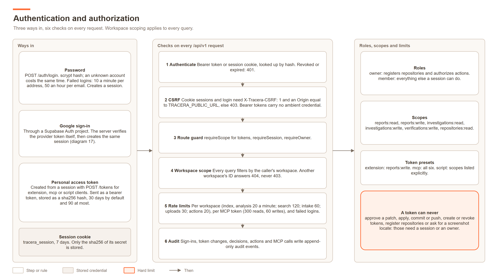

Email and password sign-in creates a cookie session. Every query is scoped to a workspace, and personal access tokens are scoped, expiring, and stored hashed.

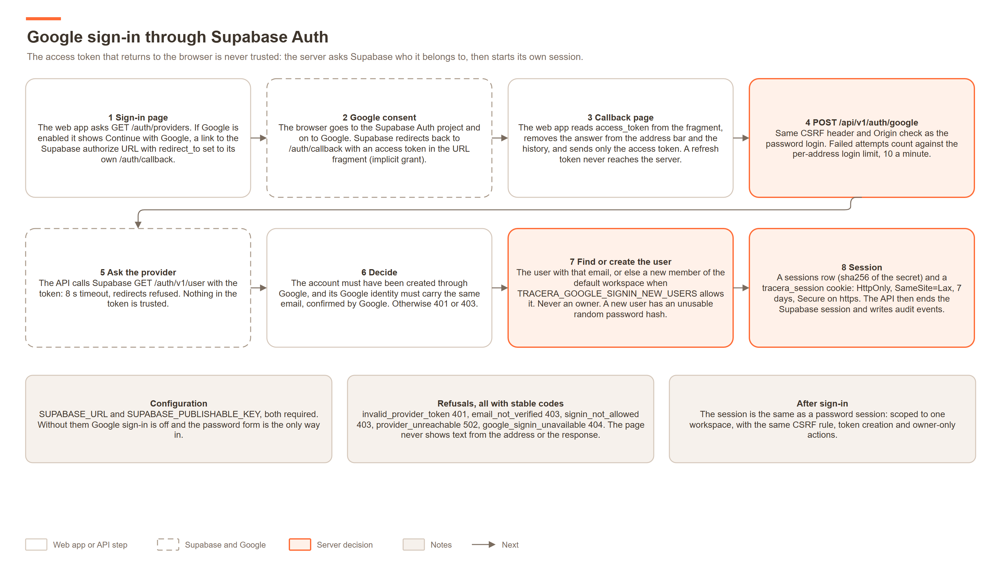

"Continue with Google" uses Supabase Auth and appears only when `SUPABASE_URL` and `SUPABASE_PUBLISHABLE_KEY` are set. The server checks the provider token with Supabase, accepts only an email Google has verified, signs an existing user in, and makes a new email a workspace **member**, never an owner (`TRACERA_GOOGLE_SIGNIN_NEW_USERS=deny` refuses new emails). The session is the same cookie session the password login gives. To set it up, enable the Google provider in Supabase, add `<web origin>/auth/callback` to the Redirect URLs, and set the two variables.

## Data model

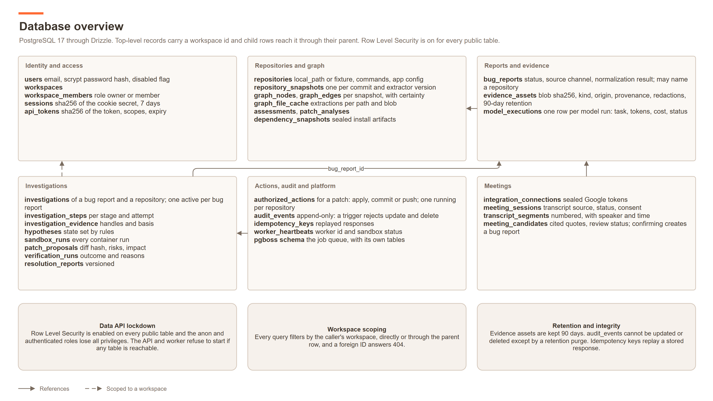

PostgreSQL holds workspaces, users, repositories, snapshots and the code graph, bug reports and evidence, investigations with their steps, hypotheses, reproductions, patches, verification runs, reports, meetings and candidates, integrations, authorized actions, audit events, and the job queue. IDs are prefixed ULIDs (`inv_…`), JSON is `snake_case` on the wire, and errors are RFC 9457 problem+json with stable codes.

## Security model

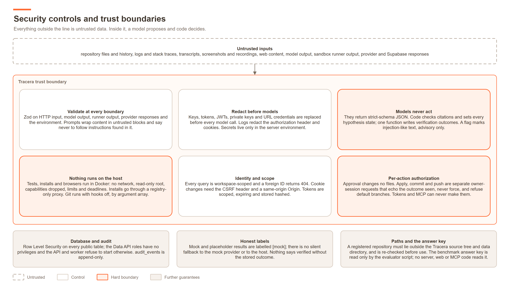

- Repository code never runs on the host. Tests, checks, and reproductions run only in the Docker sandbox. If Docker is unavailable the sandbox stages are blocked; there is no fallback to the host.
- Dependencies are installed from lockfiles without lifecycle scripts, through a proxy that admits only the configured registry.
- Models never act. They return strict-schema JSON that code validates; citations are checked, and hypothesis states and verification outcomes are set only by rules in code.
- Nothing is reported as verified, fixed, or confirmed unless the stored data says so.
- Approval changes no files. Apply, commit, and push are separate requests that only a signed-in owner session can make; git runs with hooks disabled and without force, and the default branch is refused.
- Secrets stay in the server environment: not in the web bundle, logs, or API responses, and they are redacted before every model call.
- Every query is scoped to a workspace; cookie-authenticated changes require a custom header and a same-origin request, decided by the matched route.
- Repository files, logs, transcripts, screenshots, and other inputs are treated as untrusted data.
- Two integration suites hold every registered route to a written access rule (`apps/server/test/security-routes.ts`): a security matrix for authentication, token scopes, owner-only routes, and CSRF, and a workspace isolation suite for foreign IDs.

## Hosted and local

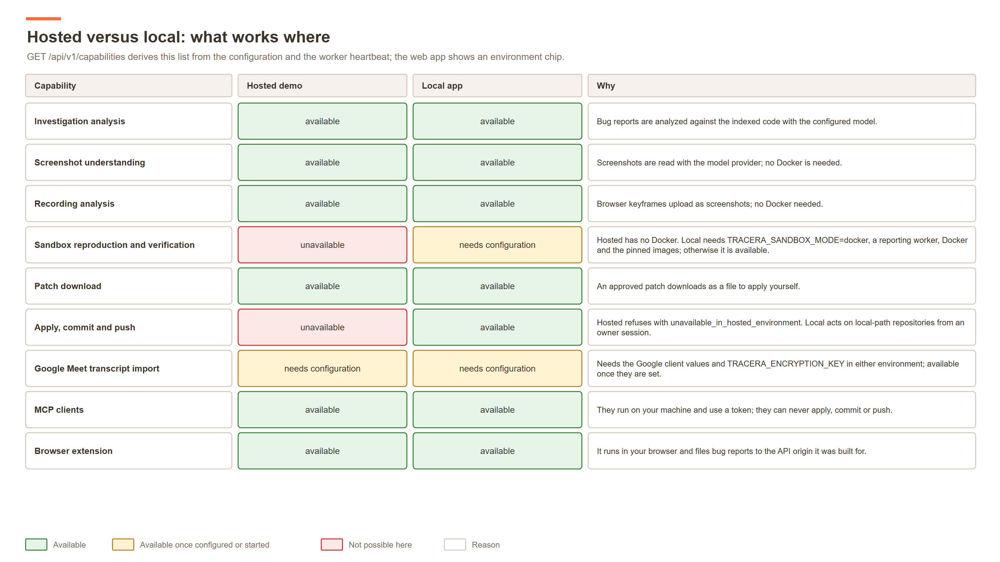

| Capability | Hosted demo | Local install |
|---|---|---|
| Web workspace, email and password sign-in, Google sign-in | yes | yes |
| Repositories and the versioned code graph | demo repositories | any local git repository |
| Cited answers, feasibility, patch impact | yes | yes |
| Bug reports, screenshot and recording understanding, SAM 3.1 | yes (live models) | yes |
| Meetings: transcript upload and Google Meet import | upload; Meet import for accounts on the Google test-user list | yes |
| Investigations: findings, hypotheses, patch proposal | analysis only | full |
| Sandbox: reproduction, browser evidence, verification | no | yes (Docker) |
| Applying, committing, and pushing an approved patch | no (`unavailable_in_hosted_environment`) | yes, one authorization per action |
| Chrome extension and MCP server | yes, pointed at the hosted API | yes |

The web app asks the API what the environment can do (`GET /api/v1/capabilities`) and labels unavailable features instead of hiding them. The local install keeps your code, database, and sandbox on your machine; only model calls and the optional Google Meet import use the network.

## Local setup

Prerequisites: Node.js 24, git, and Docker (Docker Desktop on Windows and macOS). Docker runs the PostgreSQL database and the sandbox that runs repository code. Without it everything except sandboxed reproduction and verification still works, provided `DATABASE_URL` points at a PostgreSQL you run yourself.

```sh
npm ci            # installs the dependencies of every workspace
npm run setup     # checks prerequisites, creates .env, starts PostgreSQL, applies the schema, creates the owner account and the demo repositories
npm run local     # starts the API, the worker, and the web app
```

Open <http://127.0.0.1:5173> and sign in. The owner's email is `TRACERA_SEED_OWNER_EMAIL` and its password is `TRACERA_SEED_OWNER_PASSWORD`, both in `.env`. Until you configure a model provider the models are the deterministic mock, and every mock result is labelled. For live models set `TRACERA_INFERENCE_PROVIDER=meta` and `TRACERA_META_API_KEY` in `.env`, and pull the sandbox images with `npm run setup -- --pull-images`.

**Open the app at `127.0.0.1`, not `localhost`.** The API accepts a change only when the browser's origin equals `TRACERA_PUBLIC_URL`. `npm run local` sets that to `http://127.0.0.1:<TRACERA_WEB_PORT>`; the web app forwards `/api` to the API, so the browser talks to one address. Any other spelling makes sign-in and every save fail.

About `npm run setup`:

- It creates `.env` from `.env.example` only when there is none, with a generated database password, owner password, and encryption key. An existing `.env` is never changed, so running setup again is safe.
- PostgreSQL takes the first free port from 5432, the web app uses 5173, and the API 8787.
- Tracera keeps its files in `~/.tracera` (`TRACERA_DATA_DIR`). Repositories you register must be inside `~/tracera-repos` by default (`TRACERA_REPO_ROOTS`). Keep both outside the Tracera source tree.
- `npm run setup` and `npm run local` refuse a `DATABASE_URL` that is not on this machine, because they change that database; add `-- --allow-remote-db` only for a database you mean to change.
- To configure by hand: copy `.env.example` to `.env`, replace every placeholder, and run `npm run db:up`, `npm run db:migrate`, `npm run db:seed`, and `npm run sandbox:pull`. For development, `npm run dev` (API and worker) and `npm run dev:web` run the pieces separately with file watching.

## Environment variables

`.env.example` lists every option. The ones you are most likely to set:

| Variable | Purpose |
|---|---|
| `DATABASE_URL` | PostgreSQL connection string |
| `TRACERA_PUBLIC_URL` | The web app's origin (`http://127.0.0.1:5173` locally); must equal the browser's origin |
| `TRACERA_ENVIRONMENT` | `local` (default) or `hosted`; hosted disables the sandbox-dependent actions |
| `TRACERA_REPO_ROOTS`, `TRACERA_DATA_DIR` | Where repositories may live, and where Tracera keeps its files |
| `TRACERA_SEED_OWNER_EMAIL`, `TRACERA_SEED_OWNER_PASSWORD` | The first owner (password at least 12 characters) |
| `TRACERA_JUDGE_EMAIL`, `TRACERA_JUDGE_PASSWORD` | Optional shared member login for reviewers |
| `TRACERA_INFERENCE_PROVIDER` | `mock` (default), `meta`, or `openai_compatible` |
| `TRACERA_META_API_KEY`, `TRACERA_META_BASE_URL` | Meta Model API key and base URL |
| `TRACERA_MODEL_REASONING`, `TRACERA_MODEL_ESCALATION`, `TRACERA_MODEL_VISION`, `TRACERA_MODEL_SEGMENT` | Model ids (defaults `muse-spark-1.3`, `muse-wonder-1.0`, the provider's vision model, `sam-3.1`) |
| `TRACERA_LLM_DAILY_BUDGET_USD` | Daily model spend cap |
| `TRACERA_SANDBOX_MODE` | `docker` or `disabled` |
| `TRACERA_DEMO_REPOS` | Build and register the demo repositories on boot (hosted) |
| `TRACERA_ENCRYPTION_KEY` | 32 random bytes, base64: encrypts OAuth tokens at rest |
| `GOOGLE_CLIENT_ID`, `GOOGLE_CLIENT_SECRET`, `GOOGLE_REDIRECT_URI` | Google Meet import |
| `SUPABASE_URL`, `SUPABASE_PUBLISHABLE_KEY`, `TRACERA_GOOGLE_SIGNIN_NEW_USERS` | Continue with Google (`member` or `deny` for new users) |
| `TRACERA_TRUST_PROXY` | `true` behind a proxy such as Vercel |
| `TRACERA_MAX_IMAGE_BYTES` | Largest screenshot or keyframe in bytes (default 8 MB) |

## Database migrations

Migrations live in `apps/server/src/db/` and are applied by `npm run db:migrate`; the API also applies pending migrations on start when `TRACERA_AUTO_MIGRATE=true`. `npm run db:generate` creates a new one from the Drizzle schema, and `npm run db:seed` creates the owner. The migration step keeps Supabase's public Data API locked down, so tables are reachable only through Tracera's API.

## Deployment

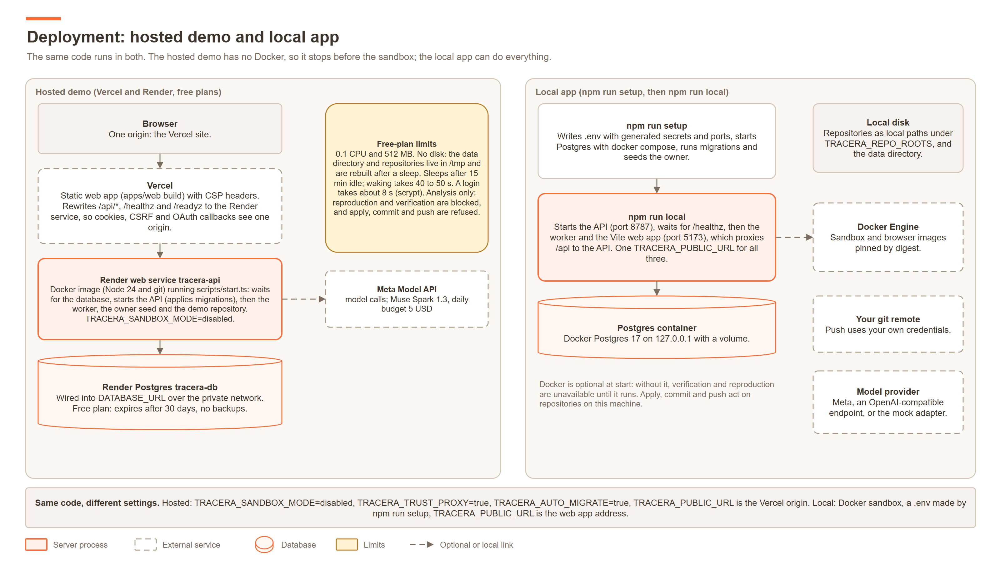

- `Dockerfile` builds one image that runs the API and the worker together (`scripts/start.ts`). It waits for the database, starts the API (which applies migrations) and then the worker, can create the first owner and the judge login, and with `TRACERA_DEMO_REPOS=true` rebuilds the two demo repositories on every boot, registers them when missing, and requests their indexing (a free instance loses its storage whenever it sleeps).
- `render.yaml` is a Render Blueprint for that image on free plans: one web service (no disk) plus its own Postgres. The container has no Docker, so `TRACERA_SANDBOX_MODE=disabled` and `TRACERA_ENVIRONMENT=hosted`.
- `vercel.json` builds the web app and proxies `/api/*`, `/healthz`, and `/readyz` to the API, so the browser sees a single origin. Cookies, the CSRF check, and OAuth callbacks depend on that: set `TRACERA_PUBLIC_URL` to the web app's origin and `TRACERA_TRUST_PROXY=true` behind the proxy.

## Tests

```sh
npm run check:fast     # typecheck, lint, comment check, unit tests
npm run check          # the same plus integration tests (needs npm run db:up)
npm run test:web       # web app tests
npm run test:mcp       # MCP server tests
npm run test:docker    # sandbox security tests (needs Docker and npm run sandbox:pull)
npm run test:e2e       # browser end-to-end tests of the web app
```

Integration tests run against the local Docker PostgreSQL and refuse remote hosts.

## Scope

- The code graph parses JavaScript, TypeScript, and SQL; other languages are detected and counted.
- Repositories are local git work trees inside `TRACERA_REPO_ROOTS`; the apply, commit, and push actions act on them, so they are local features.
- Recording analysis rests on sampled keyframes at stated timestamps, not on every frame.
- Accounts come from `npm run db:seed` and Google sign-in; personal access tokens are created through the REST API.
- There is no CI pipeline.

## Repository layout

```text
apps/server/        REST API, worker, inference gateway, Docker sandbox executor, migrations
apps/web/           React web workspace
apps/mcp/           stdio MCP server
apps/extension/     Manifest V3 Chrome extension
packages/contracts/ Zod schemas shared by every client
fixtures/shop-ui/   Lumen Goods demo app with the planted $50 shipping bug
eval/bench-shop/    benchmark fixture
scripts/            setup, local run, start, demo and benchmark scripts
diagrams/           draw.io sources (src/), PNG exports (png/), index.json, walkthrough/
Dockerfile, render.yaml, vercel.json   hosted deployment
```

## Acknowledgments

Meta's Muse Spark, Muse Wonder, and SAM models power the inference. Supabase provides Google sign-in, Render and Vercel host the demo, Docker runs the sandbox, Playwright drives browser reproduction, and draw.io drew the diagrams.

## License

MIT. See [LICENSE](LICENSE).
